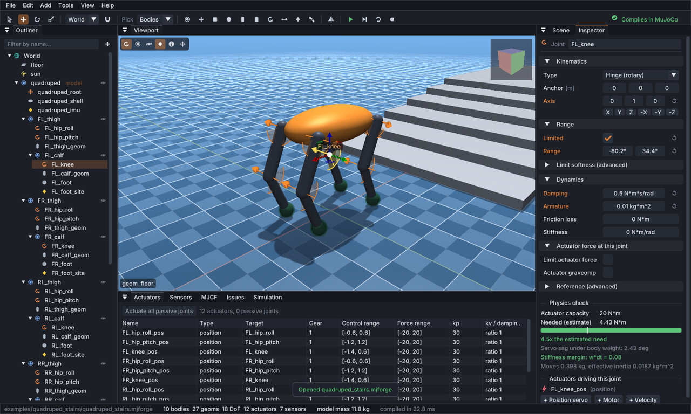
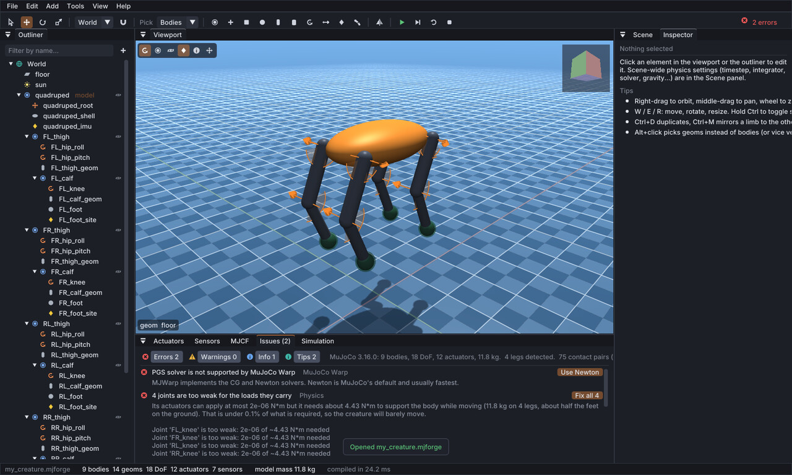
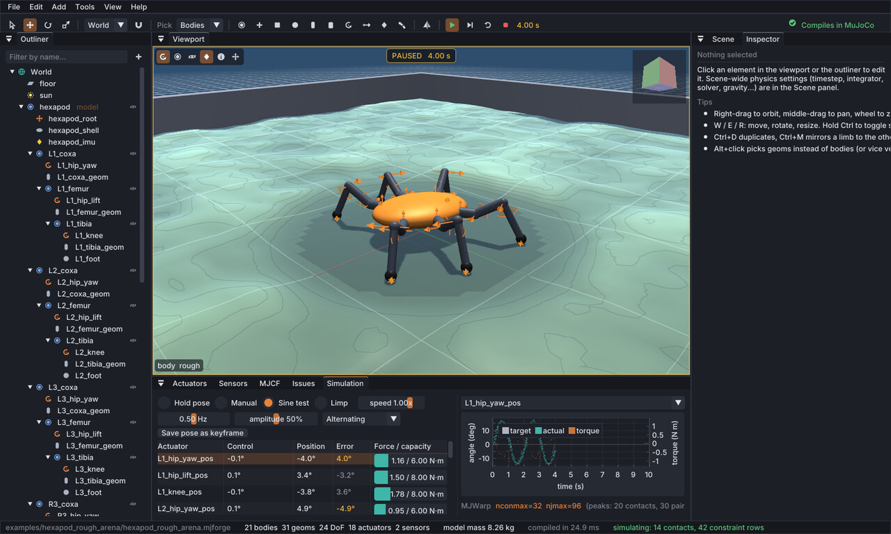

# MJForge

A fast, native visual editor for building **creatures, robots and environments** for
[MuJoCo](https://github.com/google-deepmind/mujoco) and
[MuJoCo Warp](https://github.com/google-deepmind/mujoco_warp), aimed at reinforcement-learning work.

Build from MuJoCo's geometric primitives with complete freedom, see live whether the model compiles
and makes physical sense, press Play to watch it in MuJoCo, and export clean MJCF together with a
ready-to-run MuJoCo Warp loader.



## Features

**Build**
- Bodies, geoms (box, sphere, capsule, cylinder, ellipsoid, plane, height field, mesh), joints
  (hinge, slide, ball, free), sites, cameras and lights, with gizmos, snapping, undo and
  multi-selection editing. Meshes load from STL, OBJ or MSH files through MuJoCo itself. Every MuJoCo attribute that matters for physics is in the Inspector, with MuJoCo's
  documentation in the tooltips.
- All actuator types: motor (torque), position servo (target angle), velocity, integrated velocity,
  damper, cylinder, muscle, adhesion and general, plus friction, armature, damping, mass and
  inertia per element.
- **Tendons** (fixed joint combinations and spatial cables with wrapping and pulleys, with actuators
  and sensors on them), **equality constraints** (connect for closed loops, weld, joint and tendon
  couplings) and explicit **contact pairs**, all supported by MuJoCo Warp.
- **Add-limb tool** (G): click a body to grow a jointed limb with actuators and a foot; it is
  mirrored to the other side automatically (`leg1_left_hip`, `leg1_right_hip`, ...).
- Mirror, duplicate, linear and radial **arrays** (six hexapod legs from one).
- **Pose mode** (P): set the start pose by rotating joints in the viewport (a crouch, a raised
  arm), mirror it left/right and drop it onto the floor. It becomes keyframe 0 with matching
  position-servo targets, which training code resets to.
- **Environment generators** with live parameters: stairs, ramps, rough terrain and waves (single
  height-field geoms, cheap in MJWarp), stepping stones, obstacle fields, arena walls.
- Templates: quadruped, hexapod, biped, hopper, robot arm, empty scene.

**Understand**
- Every edit is compiled by the real MuJoCo library in the background (the UI never waits).
- A physics analysis explains problems in plain language, with numbers and one-click fixes.
  Examples: actuator strength vs. the load it carries ("a 10 kg creature whose knees can give
  2 µN·m"), servo sag, stiffness vs. timestep stability, mass ratios, start pose inside or above
  the floor, balance at rest, foot creep, servo ranges written in degrees.
- MuJoCo Warp rules: unsupported features (PGS, noslip, PID actuators, ...), the box/mesh contact
  margin trap, which contact pairs need MJWarp's slower convex collider, self-collision pair counts.



**Simulate**
- Play runs MuJoCo physics, drawn by MJForge's own lightweight renderer (not MuJoCo's).
- Control modes: *Hold pose* (servos keep the start pose; torque motors get a built-in PD),
  *Manual* sliders, *Sine test* through each joint's range, *Limp*.
- Drag bodies with the mouse to push them. Contacts and contact forces are drawn.
- Per-actuator control, position, tracking error and force against capacity, with live plots.
- **Live tuning**: change gains, masses, friction or the timestep while it runs; the state is kept.
- Instabilities are detected, attributed to a joint and explained.
- Measured peak contacts, constraint rows and MJWarp broadphase pairs give `nconmax` / `njmax`.



**Combine, import and export**
- Models and environments can be built together or separately. *File > Import into scene*
  brings the models and/or the environment of another project or MJCF file into the current one
  (replace the environment, place models side by side, names kept unique).
- MJCF import goes through MuJoCo's own parser and compiler, so defaults, includes, orientations
  and meshes behave exactly as in MuJoCo. Tested on MuJoCo Menagerie robots (Unitree Go2 and H1,
  ANYmal C, Franka Panda, Agility Cassie, Robotiq 2F-85, Shadow and Allegro hands, ALOHA): the
  re-exported files compile to the same masses, inertias, tendons and constraints, and simulate the
  same trajectories.
- Keyframes: the first one is the start pose of simulations and exported models; pose it in the
  viewport or capture one from the simulation.
- Unsaved changes are never dropped silently: quitting or opening another project asks first, and
  modified projects are autosaved in the background and recovered after a crash.
- Export one file, or a model file plus a scene file that includes it (the Menagerie layout), and
  optionally a `name_mjwarp.py` loader with measured buffer sizes. Big meshes are written as STL
  files and texture images are copied into `name_assets/`, so the export folder is self-contained.

## Building

Requirements: a C++17 compiler, CMake 3.20 or newer, OpenGL 3.3, and MuJoCo 3.16. The easiest way
to get MuJoCo is the Python package, which ships the C library and guarantees MJForge validates with
the same MuJoCo that MuJoCo Warp uses:

```bash
python3 -m pip install mujoco==3.16.0
cmake -S . -B build -G Ninja -DCMAKE_BUILD_TYPE=Release   # finds MuJoCo through python3
cmake --build build
./build/bin/mjforge
```

Other dependencies (GLFW, Dear ImGui, ImGuizmo, ImPlot, nlohmann/json, doctest) are fetched by
CMake. On Linux, GLFW needs the X11 development packages
(`libx11-dev libxrandr-dev libxinerama-dev libxcursor-dev libxi-dev libgl1-mesa-dev`).
To use a MuJoCo release folder instead of the Python package, pass `-DMUJOCO_DIR=/path/to/mujoco`;
`-DPython3_EXECUTABLE=...` selects a specific Python. Tests: `./build/bin/mjforge_tests`.

CI builds and runs the tests on Linux, Windows (MSVC) and macOS (Apple clang). On Windows, CMake
downloads the MuJoCo release (the Python package has no import library); on macOS it uses the
library inside the Python package.

## Using it

Start from a template (*File > New*, or the welcome card), or from an empty scene with
*Add > Model*. A typical loop: build, read the Issues panel, press Space to simulate, tune values in
the Inspector while it runs, then *File > Export MJCF* (Ctrl+E). The [user guide](docs/USER_GUIDE.md)
walks through every panel.

| Mouse | |
|---|---|
| Left click / Shift / Ctrl | select / add / toggle (Alt picks geoms instead of bodies) |
| Right drag | orbit; right click: context menu |
| Middle drag, Shift + right drag | pan |
| Wheel | zoom toward the cursor |
| Left drag while simulating | push the body under the cursor |

| Keys | |
|---|---|
| Q W E R | select, move, rotate, resize |
| Tab | gizmo in world / local frame |
| G | add-limb tool |
| P | pose mode (start pose) |
| F / Home | frame selection / frame everything |
| Ctrl+D, Ctrl+M, Del | duplicate, mirror left/right, delete |
| Ctrl+Z, Ctrl+Y | undo, redo |
| Space, Shift+Space | play/pause, stop simulating |
| Ctrl+R, Right arrow | reset simulation, single step (paused) |
| X, J, C, L | x-ray, joints, centers of mass, names |
| Ctrl+S, Ctrl+O, Ctrl+I, Ctrl+E | save, open (project or MJCF), import into scene, export |

## Training with MuJoCo Warp

Exported files load with `mujoco.MjModel.from_xml_path()` and `mujoco_warp.put_model()`. MuJoCo
Warp preallocates contacts (`nconmax`) and constraint rows (`njmax`) per world; too small and
contacts are silently dropped. Its broadphase also needs room for every candidate geom pair, which
can exceed the number of actual contacts. MJForge measures all three during the simulation preview
and writes them into the loader script:

```python
mjm = mujoco.MjModel.from_xml_path("quadruped_stairs.xml")
mjd = mujoco.MjData(mjm)
if mjm.nkey:
  mujoco.mj_resetDataKeyframe(mjm, mjd, 0)  # start pose
m = mjw.put_model(mjm)
d = mjw.put_data(mjm, mjd, nworld=1024, nconmax=16, njmax=24)
```

`tools/check_mjwarp.py file.xml --device cpu` cross-checks an exported file: it runs the same
rollout in MuJoCo C and MuJoCo Warp, reports overflows, and suggests sizes. The `examples/` folder
holds projects with their exported XML and loaders, all verified this way.

## Command line

```bash
mjforge robot.xml --validate            # compile with MuJoCo and print the analysis
mjforge scene.mjforge --export scene.xml --loader  # MJCF + scene_mjwarp.py
mjforge --template hexapod --save hexapod.mjforge
mjforge robot.xml --save robot.mjforge  # convert MJCF to a project
```

## Repository layout

```
src/core       document model, operations, kinematics and mass properties, MJCF writer,
               project files, templates, environment generators, merging documents
src/analysis   physics analysis, MuJoCo Warp rules, explanations and fixes
src/sim        MuJoCo bridge (background compile), simulator, MJCF import, MJWarp loader
src/render     OpenGL renderer, debug drawing, camera
src/ui         editor panels, viewport, inspector, simulation panel, tools
tests          unit and integration tests (doctest)
tools          MJWarp verification script, MJCF documentation generator
examples       example projects with exported MJCF and MJWarp loaders
```

The design and milestones are in [PLAN.md](PLAN.md).

## Limitations

- SDF geoms from imported files are approximated by boxes (bodies keep exact masses and inertias).
- Flex objects, skins and plugins in imported files are reported and skipped.

## Third-party software

MuJoCo (Apache-2.0), GLFW (zlib), Dear ImGui, ImGuizmo and ImPlot (MIT), nlohmann/json (MIT),
doctest (MIT), glad (generated loader), stb (public domain / MIT), Inter and JetBrains Mono fonts
(SIL Open Font License, see `assets/fonts`).
